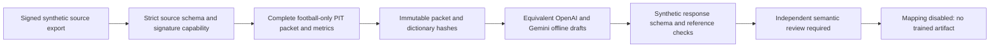

# A4 independent football intelligence — Stage 3A/3B

**Isolated offline research only. No inference transport, financial reservation, fitted coefficients, odds integration, probability forecast, value recommendation or production import.** Accepted Stage 1/2 and all original research/runtime/financial code remain unchanged.

## Trust and processing flow

Real prospective authority is deliberately **unconfigured**. The existing Phase 7 verifier also only supports synthetic source authority. An arbitrary signing key, a JSON `verified` field, a fixture date or a fresh database read cannot establish real historical availability. `verifyBundle` can only verify an explicitly synthetic export under an explicitly synthetic key. It issues an in-process, deeply frozen capability; JSON copies cannot forge it. No synthetic capability or request draft is certified prospective. `inspectExploratory` permits honest missing original receipts but still rejects known late facts, target results and prohibited content; exploratory packets cannot prepare model drafts.

## Modules and interfaces

| File | Implemented role |
|---|---|
| `definitions.json` | Twelve topics, eight feature IDs and approved signs, football field dictionary, units, metric definitions and source scope |
| `source.schema.json` | Closed input/source contract; fixture identity/receipt; cutoff/freeze/deadline; full history scope and observation inventory; typed observations with source refs, missingness, effective/played/received times and historical period |
| `packet.schema.json` | Closed emitted packet contract, including all original observations, dictionary, exact scope, derived metrics/denominators, contradictions, limitations and content hash |
| `response.schema.json` | Closed active v0.2.0 response contract; exact fixture/hash, twelve ordered topics, eight ordered categorical features, citations, warrants, structured numeric claims, abstention and contradictions |
| `bounds.mjs`, `schema.mjs` | Bounded inert JSON, duplicate/prototype/accessor/cycle/hidden-field rejection, schema and semantic input checks; no HTTP |
| `provenance.mjs` | `verifyBundle(bundle,{mode:'synthetic',publicKeyPem})`; `inspectExploratory(source)`; immutable private capability registry. No real trust-root or signing/receipt writer API |
| `evidence.mjs` | `buildEvidencePacket(capability)`: validates full scope/PIT/identity/statistic periods, preserves observations, computes deterministic metrics, hashes and freezes packet; forged packet copies fail `assertPacket` |
| `artifacts.mjs`, `prompt.mjs` | Enforces checked-in expected hashes and exact active/baseline prompt/schema/dictionary bytes at module load |
| `response.mjs` | `validateResponse(rawJSON,packet,{model})`: strict syntax/schema/identity/citation/arithmetic/direction checks; invalid, abstained and pending-review outcomes distinct |
| `capacity.mjs` | `prepareOfflineRequest(packet,explicitPlanningBounds)` and `measureResponse(rawJSON,boundBytes)`; byte checks and equivalent model-specific drafts, never provider admission/dispatch |
| `mapping.mjs` | `buildMappingInterface(acceptedOfflineResponse)`: traceable candidate categories and missingness; **all usable levels null**, mapping disabled, no rates/coefficient API |

## Complete football evidence

The source export contains exact target fixture/team/competition identities, regulation settlement, observed fixture receipt, and a source-signed complete observation inventory. Required historical match IDs/team/opponent/venue/played times are explicit, with required-field profile. Each observation has a unique ID, original source record reference, field/value/missingness, original receipt/effective/played clocks and period. No complete raw MatchMind fixture object is serialized to the analyst. Unknown or unapproved fields, nested objects, numeric forecast aliases, non-football origins and target-match historical values are rejected. Narrative/name/namespace checks supplement closed field/provenance checks; they do not constitute a universal semantic injection detector.

All observations are preserved, including unknown/not-collected entries and contradictions. The required inventory cannot be shortened to pass size checks. This builder does not choose the source universe or change the existing sixty-month evidence requirement. A future source-admission policy must freeze the actual required complete history, fields, competitions and page inventories; a caller-declared synthetic scope is not proof that a real provider returned every relevant match.

Target identity receipt and each known observation receipt strictly precede cutoff; effective time cannot exceed receipt/cutoff. Historical played time precedes receipt/cutoff and lies in the declared scope. `cutoff <= packet freeze < issuance deadline < kickoff`. Canonical UTC timestamps preserve microseconds using the accepted time utility. Missing original availability only permits labeled exploratory use. No timestamp is generated or backdated by these modules. The clocks are source claims authenticated only synthetically here, not genuine live server receipts.

Shared historical fixture IDs require reciprocal teams, same played instant and complementary/neutral venue orientation. Reciprocal score conflicts and shots-on-target/total-shots contradictions stay visible and invalidate dependent metrics. Historical first-half/extra-time/unknown periods cannot become regulation statistics. Head-to-head references only include meetings with the other target team. No automatic source-correction winner is chosen.

## Deterministic metrics and twelve topics

Preserve all raw football observations. For each team compute all/last-five/last-ten/home/away arithmetic means for admitted numeric fields. Numerator is the sum of one non-conflicting observed field value per declared match. Denominator is actual observed count; expected denominator counts the complete window. Missing values are not zero. Conflicts return null. `complete` means declared data coverage, **not adequate statistical power or calibration**.

Paired regulation scores derive historical BTTS, scoreless, multi-goal, clean-sheet frequencies and mean total goals with paired denominators. They are descriptive fractions, never target probabilities. Elapsed days since the latest declared match is labeled precisely and remains incomplete for claims of total rest because schedule coverage is not independently proven.

Twelve topic inventories expose relevant source references, explicit missingness and data limitations. Tactics/player/context/opposition evidence is not inferred from scores or reputation. A formation is not pressing intensity; high totals are not proof of openness. Opposition-strength bridges, true player importance, verified travel and complete scheduling are unavailable unless separately sourced/reviewed. No engine-produced rate, original forecast, odds, other AI response or target outcome can be an input metric. Available advanced football fields must pass the explicit dictionary; absent fields stay absent. A new dictionary/source mapping needs a versioned review, not silent field dropping.

## Prompt and response versions

Approved prompt/schema v0.1.0 remain byte-identical in `baselines/`. Active v0.2.0 retains the full twelve-area football instructions and exact eight sign meanings. The version change is explicit: structured numeric claims and feature warrants, hard bounds, source-origin labels and mandatory semantic review alter the response contract. `artifact-manifest.json` pins exact SHA-256 values, checked on import; an unversioned prompt edit fails. Future contract changes require new versioned artifacts/manifests and new validation; editing both an old manifest and old prompt is prohibited by review policy.

The model supplies analysis, source/metric references, competing evidence, limitations and ordinal categories. It supplies no probabilities, goal-rate adjustments, multipliers, odds, confidence percentages or betting picks. Numeric statements are copied only via structured claims binding exact metric value/unit/denominator/all contributing refs. Raw numeric lexemes are compared exactly, so binary rounding cannot hide fabricated precision. Digits in free prose are rejected; reference IDs and fixture identities retain their original digits. This deliberately restrictive first contract may need a reviewed provider-tested extension for source-fact quotations such as formations.

Non-null attack/vulnerability categories require correctly oriented same-team, same-window, complete underlying-xG versus surface-goal warrants; arithmetic direction must match the category. This is a **necessary consistency check**, not a manual football scoring boost or an empirical proof of sustainability. Openness needs both-team matchup observations; availability needs the correct team's documented context; schedule needs both-team context. A matching source field is still not semantic entailment. Neutral requires evidence; null remains unknown. Essential missing/conflicting score evidence cannot be called completed analysis. All eight levels are null on abstention, with typed reasons and no numerical claims.

## Validation classes and semantic limit

- `rejected`: malformed/truncated/oversized/extra fields, wrong identity/hash, unsupported references/numbers/denominators/direction, missing topics, contradictions hidden or essential evidence absent.
- `accepted_abstention`: valid abstention, retained without inventing a forecast.
- `accepted_for_offline_review`: structurally and arithmetically consistent analysis; **requires independent semantic review**, `feature_admission:false`.

Free football prose is not automatically proven true. A validator cannot establish that a citation entails a causal tactical/availability/sustainability statement simply because the ID exists. All usable mapping levels remain null. Unsupported numeric assertions are rejected automatically; non-quantitative interpretations cannot affect mathematics until a separately designed, independent, source-grounded review and genuine predictive validation admit them. No real reviewed-feature promotion API is implemented.

## Capacity and limits

Source JSON <=16 MiB, nesting <=12, nodes <=500,000, arrays <=65,536, object keys <=128, text <=8,192 characters; schema imposes smaller identity/text/claim/history limits. History <=10,000 team-match records; response <=128 KiB, schema <=64 KiB, complete request <=16 MiB. These are resource bounds, not statistical thresholds; exceedance rejects, never truncates.

Planning options are explicit: model, maximum output tokens, response byte bound, context tokens, physical output tokens and reasoning tokens. They are **caller-supplied offline scenarios**, not verified endpoint facts. Byte-as-token proxies and an unvalidated framing reserve fail conservatively, but do not establish actual token counts or provider support. The old output budget fails this conservative preparation; neither its inadequacy nor compatibility is claimed from an actual provider test. A provider tokenizer, chat/schema framing, JSON Schema subset, max completion/reasoning accounting and exact pinned endpoint must be separately verified before live admission. No configurable flag can enable admission here.

Both approved identities are preserved (`openai/gpt-6-luna`, `google/gemini-3-flash-preview`). Drafts use identical complete football message bytes and prompt/schema hashes, pinned expected provider names, no tools/search/plugins/fallback. Model identity is labeled by the offline harness, not independently proven by a model's self-description. Exact live backend contracts, current pricing/balance/BYOK/runtime/capacity/financial checkpoints and authorization remain future gates. A draft is never a dispatchable or paid-authorized request.

See `CAPACITY-MEASUREMENTS.json`, synthetic examples, `TRAINING-PLAN.md` and `STAGE3-REPORT.md`. All numerical examples/tests are synthetic; no predictive improvement or profitable value has been established.
