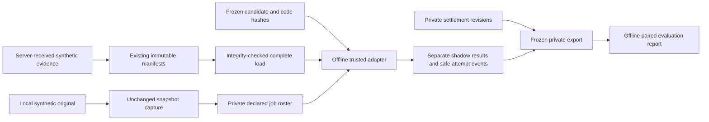

# Phase 6 offline shadow feasibility report

Date: 24 October 2026. Base: `e5580b36876b11640bcae5958b971604b3f17876`. Research reference: Phase 5 `f56caab20a5dfabc237646909058d57dac7f9a65`. Branch: `codex/phase6-shadow-feasibility`.

**Decision:** the isolated framework can execute, persist and reproduce private synthetic comparisons. It establishes **no improvement in football prediction accuracy**, no prospective evidence and no hosted integration approval. A real experimental xgEdge forecast currently abstains because no verified learned artifact exists. The live engine, public publisher, Smart Bet and UI remain unchanged.

## Original architecture and new architecture

Before Phase 6, Phase 3/4 supplied authoritative local receipt ingestion, immutable original prediction envelopes, complete chunked evidence manifests, M14 feature replay, a small pure shadow helper and a separate shadow table. It lacked a frozen candidate/job registry, complete study-level operational denominator and a reproducible evaluation workflow. Phase 5 independently supplied proper scoring/calibration/ranking code and historical research, but its source branch was not integrated with Phase 3/4.

The new `shadow_eval` schema links to the existing snapshot layer. It does not replace the existing `research.append_shadow` API. No shadow row is a public prediction. New commands use only the cached disposable PostgreSQL image through Docker exec; no hosted connection parameter exists. The existing local SQL synthetic publisher role is exercised, not a real publisher/collector process.

## Hypothesis and model decisions

Phase 5's legacy timestamp-matched cohort (816 pairs) showed weaker home/away ranking AUC: model .635/.643 versus bookmaker .704/.698, with modest average class bias. Its timestamp evidence was not authoritative historical receipt proof. This motivates a narrow hypothesis, not activation: **the existing M14 `xgEdge` may contain incremental home-versus-away ranking information conditional on the original forecast**.

The feature is computed by the actual `matchFeatures`/`providerFormFor` source through the inherited as-of adapter, with its existing five-observation minimum, eight-match provider window and 240-day age rules. There is no second feature builder or duplicate prediction engine. Unrelated missing lineups do not suppress a valid xgEdge.

Two registered adapters exist:

- `identity-v1`: returns the original stored vector directly, including rounded sums such as .9999.
- `m14-xgedge-v1`: a feasibility-only one-coefficient conditional win-share form. For home/draw/away `(h,d,a)` and feature `x`, use `q=logistic(log(h/a)+beta*x)` and return `((h+a)*q,d,(h+a)*(1-q))`. The draw and stored home+away mass are preserved; beta zero returns the original vector exactly. Boundary home/away zeros refuse execution. **Only an explicitly synthetic coefficient in a synthetic study can execute.** Historical use of that artifact falls back. Beta .1 in the fixture exercise is an arbitrary numerical test coefficient, not fitted or recommended for football.

No real coefficients were fitted, no new holdout was opened, and no future outcomes were passed to an adapter. M14's existing ridge target is an expected-points residual, not a 1X2 distribution; inventing a conversion was rejected. Full M14 activation, new Poisson engines, draw/rho changes, recency retuning, blind probability boosts, post-issue backfills, market-only claims of incremental skill and paid AI were rejected or left outside scope. The next model work must learn and validate a narrow coefficient from independently eligible inputs; this phase does not pretend those inputs already exist.

## Significant implementation decisions

1. Candidate identity freezes configuration, required features, adapter hash, actual feature-source hash, and an executable bundle hash covering executor, adapter, feature-input bridge and timestamp/canonical validation. The caller freeze time and authoritative database registration time are distinct. SQL version uniqueness prevents configuration replacement; runtime detects code/configuration changes.
2. Immutable jobs are declared before execution, including a frozen original source even when snapshot capture failed. This makes missing work visible independently of result/attempt persistence. The export freezes current roster membership; it is not a prospective study registration or sealed holdout.
3. Complete manifests are integrity-checked and loaded without truncation. Strict microsecond receipt-before-issue, observation/receipt equality, played-time rules and original target identity govern model inputs. Late captures and unknown provenance abstain. Ordered historical baseline-engine inputs still do not exist, so preserving saved probabilities is not an exact engine replay claim.
4. Results are private and immutable with one result per candidate/snapshot job. SQL rechecks candidate/configuration, baseline and evidence-root lineage, synthetic-artifact policy, valid output and exact fallback. Concurrent retries lock the declared job; a reproduced duplicate-key race was corrected. Changing a result is a conflict, not an overwrite.
5. Safe fixed-code attempt events describe execution/persistence outcomes. `runJob` reports persistence and monitoring separately, so database failure cannot appear as a successfully recorded forecast. Roster reconciliation survives a full/erroring event store. Retries are events, never extra predictions.
6. Label revisions are fixture-bound, operator-only, append-only and server-received. Report cutoff excludes later labels and result receipts. The existing 48-hour void rule and valid FT-pair preference are reused. Private accuracy comparisons withhold AET/PEN records without a verifiable valid 90-minute pair; the public provider-score fallback is unchanged. Padded status normalization is tested.
7. The study export contains the odds observations needed for scoring plus complete manifest hashes; full historical evidence stays in PostgreSQL and the private backup. An initial realistic run exposed repeated-history export growth beyond the harness's 64 MiB command buffer; the compact export corrected that without dropping model inputs. Oversized single-job evidence reads still fail explicitly rather than truncate; a streaming replay reader is future work if required.
8. Both private schemas share the original 250 MiB control lock/admission. Local overrides extend accounting to shadow relations/indexes and guard inherited capture-health writes, which previously bypassed quota admission. Up to 1 MiB is reserved inside the ceiling for bounded operational data; operational writes allow 64 KiB for physical page/index/sequence growth. Caps: 8 shadow events/job, 10,000 total shadow events, 10,000 inherited health fixtures, 64 health attempts/fixture. Exhaustion remains reconcilable; it never increases the budget.
9. Role/RLS tests exercise NOLOGIN private operator/runner/reader boundaries. Ordinary app roles cannot access the schema. The runner cannot insert public predictions, mutate originals or change registry/results. Trusted Docker administrators, database owners and repository adapter code remain privileged; this is not a sandbox for malicious uploaded JavaScript.
10. The local test harness now uses `--pull=never`; CI selects the existing Node matrix and inherited PostgreSQL image. No Supabase installation, project access, external football requests, AI credentials, paid resources, merge or deployment is part of this work.

## Exact Phase 5 integration and test scope

Copied byte-for-byte from `f56caab`: `audits/phase5/validation.mjs` and `audits/test/phase5-validation.test.mjs`. Phase 6 calls **`paired`, `calibration`, `wilson`**. Other exported helpers (transforms, blending, timestamp prerequisites and retrospective fitting/proxies) remain in the identical module for traceability but are not used to fit or transform Phase 6 forecasts. Their synthetic regression tests are retained.

Not copied: Phase 5 production extraction SQL, historical raw export, report artifacts, analysis program, saved-lambda adapter or its two additional test files. No PR merge or cherry-pick was used. Thus the combined run validates **the inherited 107 tests plus this seven-test Phase 5 subset plus 21 Phase 6 tests**, not both complete PR suites jointly.

Final local verification, after the review corrections:

| Check | Result |
|---|---|
| Node 24.19.0, `node --test audits/test/*.test.mjs` | **135 passed, 0 failed, 0 skipped**; about 120 seconds |
| Node 20.20.2, identical suite | **135 passed, 0 failed, 0 skipped**; about 72 seconds |
| Frozen synthetic study re-scoring on both runtimes | Byte-identical JSON |
| Final local exercise | 30 original snapshots, 60 separate forecasts, complete manifests and 30 paired market fixtures per candidate |
| Backup/restore and nondestructive rollback | Passed within the combined integration suite |
| Changed-file credential-pattern, scope and aggregate-only artifact checks | Passed; no raw study export or backup committed |
| Public engine/UI/publisher diff against `e5580b3` | Empty; protected remote refs and both existing draft PR heads verified unchanged |

Tests cover original immutability; receipt/calendar/microsecond rejection; missing histories and late imports; frozen version/configuration/code; shadow isolation; exact fallback; bookmaker eligibility; paired fixture identity; 90-minute outcomes and 48-hour boundaries; concurrent retries; model/write failures; ordinary-role denial; shared-budget exhaustion; monitoring limits; backup/restore; rollback; and identical frozen-export reporting. GitHub CI uses the same full Node matrix; its final status is linked in the new draft PR rather than presumed from local success.

The fresh independent code review found and reproduced three defects before delivery: inherited health writes bypassed shared admission; attempt allowance underestimated page/index growth; padded extra-time statuses bypassed the FT safeguard. Each received a failing regression followed by a passing correction. A further source-identity check freezes the executor/input-validation bundle as well as the model source. No material finding is intentionally deferred. Operational counts remain export-wide rather than reconstructed as-of operations, and missing-snapshot coverage is separate from explicit fallback rate; those interpretations are documented rather than represented as prospective statistics.

## Synthetic measurements and storage planning

The committed aggregate artifact records the final exercise. It uses 1,440 synthetic historical fixtures across teams, competitions and seasons; 30 target originals (ten repeated-team targets followed by diverse teams/two competitions); 52,080 stored field observations; two candidates/60 private jobs; and complete manifests of approximately 4,292–9,344 observations. Unique target/odds context produces distinct roots while chunks reuse eligible historical inputs. All synthetic success cases and market pairs are expected to be available by construction; this is **not** a real-world coverage estimate.

The final workload measured snapshot capture about **346 ms median / 415 ms p95 / 497 ms maximum**; full shadow jobs about **509 / 839 / 897 ms**. Median complete load was 316 ms, persistence 89 ms and monitoring 89 ms. The pooled adapter sample includes identity and xgEdge; its p95 was 316 ms and is not an identity-free model timing. Parent Node peak RSS was about 355 MiB, excluding PostgreSQL/child processes. These are shared-workspace feasibility observations, not concurrency service-level guarantees. `results/2026-10-24-feasibility.json` contains the final rerun after corrections.

In that workload, combined relations/indexes grew from approximately 48 MiB after archive seeding to 94 MiB after 30 originals/60 shadow results. New shadow per-job slopes were conservatively about 6.8 KiB data and 2.8 KiB indexes, including roster, result, settlement and attempt storage. Database catalogue/WAL/backup/image space is separate. Admission estimates and row caps are not an OS-enforced physical hard quota; failed transaction allocation/bloat still needs actual-size monitoring and conservative stop thresholds.

Planning reuses Phase 4's measured raw-observation, polling, manifest-diversity and history-growth slopes, adds measured shadow/registry overhead for two candidates and preserves its 25% planning reserve. Rounded final estimates are:

| Scenario | Predictions/day | Polls | 30 days | 90 days | 180 days |
|---|---:|---|---:|---:|---:|
| Small shadow pilot | 2 | 15 min, 6h/day, 1% changed fields, 95% repeat share | 118 MiB | 182 MiB | 290 MiB |
| Focused coverage | 10 | 5 min, 6h/day, 5% changed fields, 50% repeat share | 749 MiB | 2,348 MiB | 5,439 MiB |
| Broad frequent collection | 30 | 1 min, 12h/day, 10% changed fields, 10% repeat share | 5,439 MiB | 20,419 MiB | 53,578 MiB |

These are unconstrained required-capacity estimates, not permission or ability to exceed admission. The final artifact retains transparent components, measured slopes and assumptions. Reused Phase 4 archive baseline differs from this exercise's archive footprint; no newly measured polling or 180-day upper bound is claimed. Additional competitions, corrections, bloat, WAL and backups can worsen requirements. **No sustained private trial is recommended now.** Even the smallest scenario breaches 250 MiB by 180 days, and its 360 originals in 180 days would be far short of Phase 5's illustrative precision needs. The actual fraction with authoritative fresh evidence and a learned candidate remains unknown; usable real learned-candidate coverage in this feasibility phase is zero.

## Statistical findings and next stage

The new results establish functional invariants only. Identity must have exactly zero paired differences; synthetic xgEdge output need only be valid, isolated and reproducible. Artificial scores, ranks and intervals in the artifact are not evidence of football skill. Reports compute summed multiclass Brier, natural-log loss, 1X2 top accuracy, class calibration and one-vs-rest AUC, fair-market contrasts, coverage/fallback rates and competition/UTC issuance-month strata. Original/candidate/market use identical fixtures in each paired contrast, including an original-on-market-subset comparison. Both intention-to-forecast baseline fallback and successful-only diagnostics are exposed.

Week and competition bootstraps are separate descriptive sensitivity analyses, not confirmatory multiway inference. A single synthetic issuance week cannot supply a week-bootstrap interval; missing intervals stay null. Small subgroups, selected market coverage, reused holdouts and source uncertainty remain material. No calendar date is automatically called prospective.

Recommended next stage: independently review this private framework, freeze a feasible evidence/label acquisition protocol, resolve receipt-capable staging and resource/retention feasibility without changing either hosted project, then investigate the single xgEdge hypothesis with genuinely eligible training/development data. Fit one probability-compatible coefficient only after defining chronological splits, label receipt cutoffs, missingness, power and dual-reference acceptance. Reserve fresh unseen issues for a later private prospective study. Do not activate the synthetic coefficient, promote a model or launch a sustained collection process from these results.

Remaining limitations include full Supabase Auth/JWT/RLS-with-Auth/PostgREST/Edge verification, actual private publisher/collector source compatibility, authoritative real outcome collection, historical ordered-engine-input replay, an independently learned artifact, completed confirmatory dependence/grading methodology, sufficient untouched sample size, streaming exceptionally large single-job manifests and external durable monitoring if the local database cannot write.

## Files, reasons and commit history

| Files | Purpose/reason |
|---|---|
| `docs/superpowers/plans/2026-10-24-phase6-shadow-feasibility.md` | Design, sequence, review-driven safeguards |
| `audits/phase6/adapters.mjs`, `core.mjs` | Frozen registry, narrow synthetic adapter, receipt-safe feature execution and fallback |
| `audits/phase6/schema.sql`, `repository.mjs`, `rollback.sql` | Private immutable storage, permissions, quota/monitor guards, lineage, local-only access and nondestructive stop |
| `audits/phase6/runtime.mjs`, `run-synthetic.mjs`, `evaluate.mjs` | Failure-aware orchestration, synthetic resource exercise and offline re-scoring |
| `audits/phase6/report.mjs`, `resources.mjs` | Paired metrics/coverage, cutoff-safe settlement and capacity arithmetic |
| `audits/phase5/validation.mjs`, `audits/test/phase5-validation.test.mjs` | Exact selective reuse from Phase 5 |
| `audits/test/phase6-{core,db.integration,report,runtime,resources}.test.mjs` | 21 new Phase 6 regressions, including independent-review reproductions |
| `audits/lib/asof-features.mjs` | One exported implementation-hash constant; existing numerical feature calculation unchanged |
| `audits/test-support/local-db.mjs` | Explicit cached-image-only container start |
| `.github/workflows/audit-regression.yml`, `.gitignore` | New branch/PR-target CI and private-data exclusion |
| `audits/phase6/results/*`, `README.md`, `REPORT.md` | Reviewed aggregate evidence, reproducible runbook and independent-review handoff |

Commits already recorded: `09f0347` plan; `44585c1` frozen adapters; `f7e204b` private repository/permissions; `a6a6107` selective Phase 5 metrics and report. `5cc2a2b` implements executable source freezing, failure-aware orchestration, resource verification and independent-review corrections. The final documentation/evidence commit is this report's commit; the complete range is visible with `git log e5580b3..HEAD` in this PR. No commits from PR #1/#2 were merged and no protected branch was modified.

Rollback is documented in the runbook and tested locally with a full restore and original-hash comparison. It revokes private writers while preserving evidence/results and shared quota accounting. There is no production restoration, deployment, live-engine rollback or public UI migration to perform.
